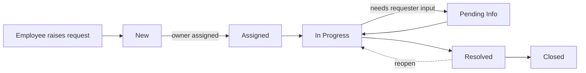

# Sample Process Flow - Request lifecycle (SAMPLE)

Plain text: New -> Assigned -> In Progress -> (Pending Info <-> In Progress) -> Resolved -> Closed.
SLA clock: starts at creation (`created_at`), stops at the first Resolved/Closed (`resolved_at`).
Each arrow writes one row to `status_history`; stage durations are computed from those rows.
